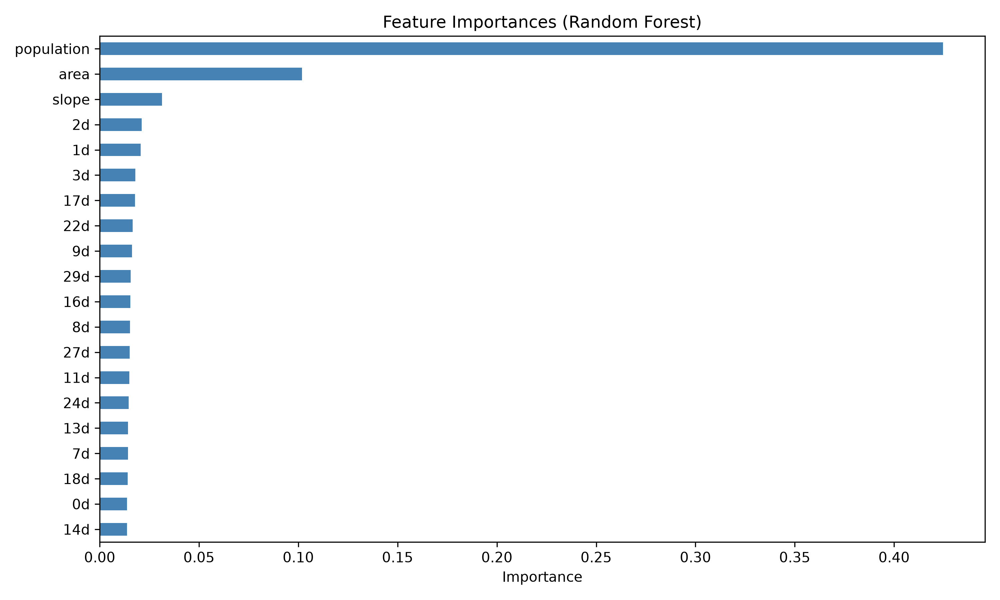

# Flood Damage Prediction — Kanto Region, Japan

Comparing five regression models on per-capita flood damage across Kanto flood
records from 1993–2020, with time-aware validation throughout.

Accompanies the paper *"A Head-to-Head Study of Ensemble and Deep Learning Algorithms
for Flood Damage Prediction in Japan"* by Parth Krishan Goswami, Jyoti Arora and Indu,
accepted at the 9th International Conference on Pattern Analysis, Understanding and Learning
(PAUL 2026). An earlier version is on Zenodo as a preprint (see [Citation](#citation)).

---

## Results

Chronological holdout — trained on 1993–2012, tested on 2013–2020 (1174 events):

| Model             |  RMSE           |  MAE            |  R²             |
|-------------------|-----------------|-----------------|-----------------|
| XGBoost           | **0.805**       | 0.634           | **0.368**       |
| Random Forest     | 0.807           | **0.633**       | 0.364           |
| Deep Neural Net   | 0.838 ± 0.008   | 0.655 ± 0.007   | 0.315 ± 0.012   |
| SVR               | 0.850           | 0.670           | 0.295           |
| Linear Regression | 0.930           | 0.741           | 0.156           |

Rolling-origin validation — five expanding windows, mean ± std across windows:

| Model             |  RMSE             |  MAE              |  R²               |
|-------------------|-------------------|-------------------|-------------------|
| XGBoost           | **0.728 ± 0.076** | **0.564 ± 0.068** | **0.394 ± 0.077** |
| Random Forest     | 0.729 ± 0.077     | 0.564 ± 0.067     | 0.391 ± 0.087     |
| Deep Neural Net   | 0.753 ± 0.067     | 0.584 ± 0.060     | 0.350 ± 0.076     |
| SVR               | 0.795 ± 0.057     | 0.621 ± 0.052     | 0.277 ± 0.067     |
| Linear Regression | 0.864 ± 0.063     | 0.679 ± 0.057     | 0.146 ± 0.081     |

In the holdout table the DNN row is the mean ± std over five seeds; in the
rolling-origin table each window's DNN prediction averages three seeds. The other
models are deterministic single fits.

The holdout table gives the figures in the accepted paper. This repository's
own run (`assets/run_log.txt`) reproduces the linear regression row, XGBoost's
RMSE and R², and the whole rolling-origin table. The other holdout rows come out
close but not identical: Random Forest 0.806 RMSE, the DNN 0.840 ± 0.003 and SVR
0.863. SVR differs because the paper's final version widened its search to 60 iterations;
that search and the paper's added checks (whole water systems held out, and paired
significance tests) aren't in this repository yet; their results are summarised below.

**XGBoost and Random Forest are statistically indistinguishable.** They finish
in the same order under both protocols, but the margin is meaningless: 0.0025
RMSE on the holdout (Diebold–Mariano p = 0.45 in the paper) and 0.001 under rolling-origin,
against a window-to-window standard deviation of 0.077. XGBoost has the lower RMSE in
4 of the 5 windows. The separation that *is* stable is the one between the two tree
ensembles and everything below them: the five models finish in the same order on the
holdout, in the rolling-origin means and on held-out water systems, and the paper finds
the DNN, SVR and linear regression significantly less accurate than XGBoost
(p < 0.001). Neither ensemble should be claimed as the winner.

### Further checks in the paper

These come from the paper and can't yet be reproduced from this repository's code.

**Unseen water systems.** Events were also split by water system with five-fold
`GroupKFold`, so every test fold contains only basins the model never saw. RMSE, mean ±
std across the five folds:

| Model             | Unseen systems, all years | Unseen systems, 2013–2020 |
|-------------------|---------------------------|---------------------------|
| XGBoost           | **0.627 ± 0.064**         | **0.766 ± 0.090**         |
| Random Forest     | 0.633 ± 0.062             | 0.778 ± 0.088             |
| Deep Neural Net   | 0.641 ± 0.070             | 0.794 ± 0.109             |
| SVR               | 0.731 ± 0.146             | 0.849 ± 0.110             |
| Linear Regression | 0.831 ± 0.169             | 0.939 ± 0.108             |

The ranking is the same as on the holdout. XGBoost keeps R² 0.39 (all years) and 0.29
(2013–2020) on unseen systems, while linear regression falls below zero. One water
system, `830303`, holds 45% of all events; holding it out alone gives XGBoost an RMSE of
0.724 (all years) and 0.908 (2013–2020).

**Significance.** On the 1,174 holdout events, each model's RMSE difference from XGBoost
was bootstrapped twice: over events (5,000 resamples) and over whole water systems
(2,000), since events from one system aren't independent. A two-sided Diebold–Mariano
test was run on the per-event squared-error differences.

| Compared with XGBoost | RMSE difference | 95% interval (events) | 95% interval (water systems) | Diebold–Mariano |
|---|---|---|---|---|
| Random Forest | 0.0025 | −0.004 to +0.009 | −0.007 to +0.020 | p = 0.45 |
| Deep Neural Net | 0.034 | excludes zero | excludes zero | p < 0.001 |
| SVR | 0.045 | excludes zero | excludes zero | p < 0.001 |
| Linear Regression | 0.125 | excludes zero | excludes zero | p < 0.001 |

**Identifier codes.** `wsysCd` and `rivCd` are near-duplicates (each river code is its
water-system code with a river number appended; r > 0.999999999 after scaling), which
gives the scaled training matrix a condition number of 4.9 × 10⁷. Target-encoding the two
codes lifts linear regression's R² from 0.156 to 0.307 and SVR's from 0.295 to 0.335,
while the tree ensembles barely move (holdout RMSE 0.811 for Random Forest, 0.807 for
XGBoost). Neither baseline catches the ensembles under any treatment.

**Population's lead is partly mechanical.** The target divides damage by population, so
population is guaranteed some predictive power. Refitting XGBoost on total damage,
`log10(damageObs)`, and ranking features by mean absolute SHAP value, population falls
from 0.485 to 0.040 and catchment area becomes the strongest at 0.248. Population still
carries information: dropping it lowers R² from 0.368 to 0.227. Catchment area beats
every rainfall day in all three versions.

**Extremes are compressed.** Every model pulls its predictions towards the middle.
XGBoost over-predicts the smallest 10% of losses by 1.12 log units on average and
under-predicts the largest 10% by 1.15; its predictions have 60% of the observed
spread (36% for linear regression).

---

## Quick start

Requires Python 3.12; `requirements.txt` pins the exact versions behind the
reported results.

```bash
git clone https://github.com/Parth-KG/Flood-Prediction.git
cd Flood-Prediction

python -m venv venv
source venv/bin/activate          # Windows: venv\Scripts\activate
pip install -r requirements.txt

cd src
python main.py
```

Runs end to end in roughly 30–60 minutes on a laptop. The dataset is included,
so no download step is needed.

To capture the full log (hyperparameters, feature selection, per-seed results):

```bash
python main.py 2>&1 | tee run_log.txt
```

The rolling-origin evaluation can be run on its own in a couple of minutes,
without rerunning the main comparison (feature selection still rewrites its two
figures):

```bash
python -c "
from config import TARGET
from preprocessing import load_and_clean, encode_categoricals, split_and_scale
from feature_selection import select_features
from rolling_evaluation import rolling_origin_evaluation

df = encode_categoricals(load_and_clean())
Xtr, Xte, ytr, yte, cols = split_and_scale(df)
_, _, sel = select_features(Xtr, Xte, ytr, cols)
rolling_origin_evaluation(df, sel, TARGET, out_csv='results_rolling_origin.csv')
" 2>&1 | tee rolling_rerun.txt
```

---

## Repository layout

```
├── src/
│   ├── config.py              paths, column groups, seeds, split ratio
│   ├── preprocessing.py       load, chronological sort, split, scale
│   ├── feature_selection.py   VIF, RF importance, mutual information, consensus
│   ├── models.py              the five models + hyperparameter search
│   ├── evaluation.py          metrics table and figures
│   ├── rolling_evaluation.py  expanding-window validation
│   └── main.py                pipeline entry point
├── dataset/
│   ├── data/                  source CSVs (Zenodo, CC-BY 4.0)
│   ├── data_structures.xlsx   variable dictionary
│   ├── readme.docx            the source dataset's own documentation
│   └── README.md              what is here and which file this project uses
├── assets/                    figures and results from a full run of this code,
│                              including run_log.txt (the full pipeline log)
├── requirements.txt
├── CITATION.cff
├── LICENSE
└── README.md
```

---

## Data

Sourced from the Zenodo repository accompanying Wakai et al. (2025), *"Historical
precipitation and flood damage in Japan: functional data analysis and evaluation
of models"*, PLoS ONE 20(2), e0318335
(<https://doi.org/10.1371/journal.pone.0318335>). Data deposit:
<https://doi.org/10.5281/zenodo.14015790>, CC-BY 4.0.

This analysis uses `DB_input+res_ptn02d14_logDmgPop.csv`:

| | |
|---|---|
| Events | 5704 |
| Water systems | 75 |
| River basins | 962 |
| Period | 1993–2020 |
| Years with events | 27 (none recorded in 2014) |
| Missing values | none |
| Duplicate rows | none |

**Geographic coverage is regional, not national.** The 75 water systems fall
into four code blocks — 45 under `12`, 12 under `08`, 11 under `14` and 7 under
`83`. The dataset's variable dictionary documents `wsysCd` only as "the code of
water system", but the first three blocks match the JIS prefecture codes for
Chiba, Ibaraki and Kanagawa, and the `83` block holds seven nationally managed
Class-A river systems (see `dataset/README.md`). The codes keep their leading zero
in the CSV (`080001`); pandas drops it when it reads them as integers. The source
study describes its scope as the Kanto and Koshin regions. Results should not be
assumed to transfer to other parts of Japan.

**Target variable:** `log10(dmgObs/pop)` — observed monetary flood damage per
resident, log₁₀-transformed. Per-capita rather than absolute damage,
so that small basins with high per-resident losses remain visible.

Rainfall columns `0d`–`29d` are basin-averaged daily precipitation (mm/km², as
the source labels it) on the day of each event (`0d`) and each of the 29 days
before it.

Three columns are dropped before modelling: `log10(dmgPred/pop)` (predictions
from the source study's own model), `damageObs` (the target's numerator — a
direct leak), and `date` (used only for chronological sorting).

---

## Methodology notes

Three choices are worth knowing about before reading the code.

**Chronological splitting.** The train/test boundary is the 80th percentile of
the year distribution, which falls at **2013** — 4530 training events (1993–2012)
against 1174 test events (2013–2020), a 79.4 / 20.6 split. Rows are sorted by
date at load time, because both `TimeSeriesSplit` and Keras' `validation_split`
slice by row position and are only meaningful on ordered data.

**Rolling-origin windows cut on years, not rows.** Five expanding windows, each
tested on a block of years disjoint from every other:

| Window | Train | Test | Rows (train / test) |
|---|---|---|---|
| 1 | ≤ 2002 | 2003–2005 | 3168 / 470 |
| 2 | ≤ 2005 | 2006–2008 | 3638 / 466 |
| 3 | ≤ 2008 | 2009–2012 | 4104 / 426 |
| 4 | ≤ 2012 | 2013–2016 | 4530 / 436 |
| 5 | ≤ 2016 | 2017–2020 | 4966 / 738 |

Splitting on row counts instead would let a single year land on both sides of a
boundary, since events are unevenly distributed across years.

**`year` is excluded as a predictor.** It is retained in the dataframe for
splitting and window labelling, but never reaches a model. Under a chronological
split every test-set year lies outside the training range: trees cannot
extrapolate past their final split point, and scaled year values push SVR and
DNN inputs beyond the domain they were fitted on. Removing it is the single
largest contributor to the DNN's performance.

**Consensus feature selection.** A feature is retained only if it ranks in the
top half by *both* Random Forest importance and mutual information — 9 features
qualify. The static and categorical columns are then appended unconditionally,
whether or not they were selected, giving 11:

```
2d, 3d, 11d, 17d, 22d, 27d, area, population, slope, wsysCd, rivCd
```

Note that `wsysCd` and `rivCd` are kept by rule, not by ranking; both score near
the bottom on mutual information. The two measures also disagree on the
remaining order — RF ranks population, area, slope while mutual information
ranks population, slope, area — which is what makes requiring agreement more
informative than either ranking alone.

<p align="center">
  
</p>

<sub>Random Forest importances, top 20. The mutual-information ranking that has to agree with it is in <code>assets/run_log.txt</code>.</sub>

Scaling (`MinMaxScaler`) is fitted on training rows only, and refitted inside
each rolling-origin window. Hyperparameters for Random Forest, XGBoost and SVR
come from a 30-iteration `RandomizedSearchCV` using five-fold `TimeSeriesSplit`
in the holdout comparison. The rolling-origin windows skip that search and use
fixed settings from `rolling_evaluation.py` (Random Forest with 300 trees; XGBoost
with 300 trees, depth 5 and learning rate 0.05; SVR with C = 10), so the two
tables compare slightly differently configured models.

For Random Forest and XGBoost the holdout search here picks the same settings as the
paper: Random Forest with 500 trees, maximum depth 10, `min_samples_split` 5,
`min_samples_leaf` 2 and half the features per split; XGBoost with 300 rounds, depth 3,
learning rate 0.05, subsample 0.6, `colsample_bytree` 1.0, `min_child_weight` 3 and L1
and L2 penalties of 1.0. SVR differs. This repository searches a small grid and picks
C = 500, γ = `auto`, ε = 0.2 (holdout RMSE 0.863). The paper ran a 60-iteration search
over C from 0.1 to 10,000 and γ from 0.001 to 10 (both log-uniform) and ε from 0.01 to
0.50, which settled on C = 437.6, γ = 0.338, ε = 0.19 (RMSE 0.850).

---

## Outputs

Running `main.py` writes to the working directory:

| File | Contents |
|---|---|
| `model_comparison_summary.csv` | metrics for all five models |
| `results_rolling_origin.csv` | rolling-origin means and standard deviations |
| `feature_importance_rf.png` | Random Forest feature importances (top 20) |
| `rainfall_correlation_heatmap.png` | Spearman correlation, antecedent rainfall |
| `predicted_vs_observed.png` | scatter plots, all five models |
| `residual_plots.png` | residuals, all five models |
| `model_comparison_metrics.png` | metric bar chart |
| `dnn_training_history.png` | DNN loss and MAE curves |

All figures render at 300 dpi. `assets/` holds the outputs of one full run of
this code, together with `run_log.txt` — the console log of that run, including
the VIF table, both feature rankings, and the rolling-origin windows with their
per-window row counts. Its holdout numbers are this repository's, not the
paper's (see Results).

---

## Reproducibility

Seeded at 42 throughout (`config.RANDOM_SEED`), with the DNN additionally run
across seeds 42–46 and reported as mean ± standard deviation.

Two details matter for exact reproduction. Feature selection returns a `sorted()`
list rather than an unordered set, because XGBoost's `colsample_bytree` samples
column *indices* — a different column order gives different results from the same
seed. And estimators run with `n_jobs=1` inside the parallel search, since nesting
XGBoost's threads under `RandomizedSearchCV(n_jobs=-1)` introduces run-to-run
variation.

---

## Citation

If you use this code, please cite the paper, and the source study and its dataset. The paper has no DOI
yet; until it does, the Zenodo preprint is the citable version.

```bibtex
@inproceedings{goswami_paul_2026,
  author    = {Goswami, Parth Krishan and Arora, Jyoti and Indu},
  title     = {A Head-to-Head Study of Ensemble and Deep Learning Algorithms
               for Flood Damage Prediction in Japan},
  booktitle = {9th International Conference on Pattern Analysis, Understanding
               and Learning (PAUL)},
  year      = {2026},
  note      = {Accepted, to appear}
}

@misc{goswami_arora_2026,
  author    = {Goswami, Parth Krishan and Arora, Jyoti},
  title     = {A Head-to-Head Study of Ensemble and Deep Learning Algorithms
               for Flood Damage Prediction in Japan},
  year      = {2026},
  publisher = {Zenodo},
  note      = {Preprint},
  doi       = {10.5281/zenodo.20084689},
  url       = {https://github.com/Parth-KG/Flood-Prediction}
}

@article{wakai_plos_2025,
  author    = {Wakai, A. and Hijioka, Y. and Yokozawa, M. and Watanabe, M.
               and Sakurai, G.},
  title     = {Historical precipitation and flood damage in Japan:
               functional data analysis and evaluation of models},
  journal   = {PLoS ONE},
  volume    = {20},
  number    = {2},
  pages     = {e0318335},
  year      = {2025},
  doi       = {10.1371/journal.pone.0318335}
}

@dataset{wakai_2025,
  author    = {Wakai, A.},
  title     = {Historical precipitation and flood damage in Japan:
               functional data analysis and evaluation of models},
  year      = {2025},
  publisher = {Zenodo},
  doi       = {10.5281/zenodo.14015790}
}
```

---

## License

Code is released under the MIT License (see `LICENSE`).

The dataset in `dataset/` is redistributed under
[CC BY 4.0](https://creativecommons.org/licenses/by/4.0/) and remains the work
of Wakai et al. (2025); attribution as above.

---
